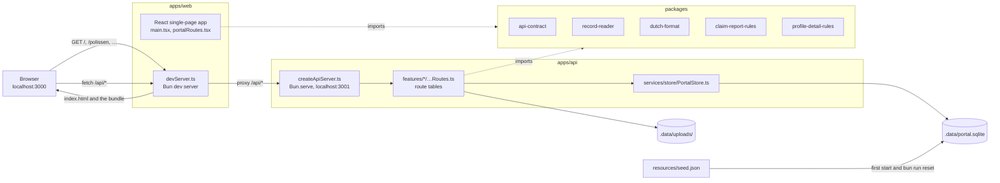
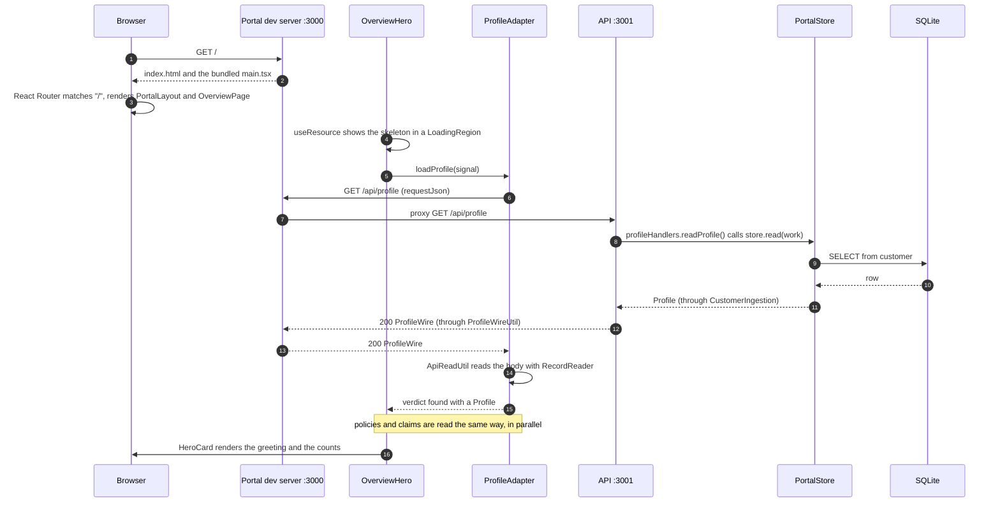
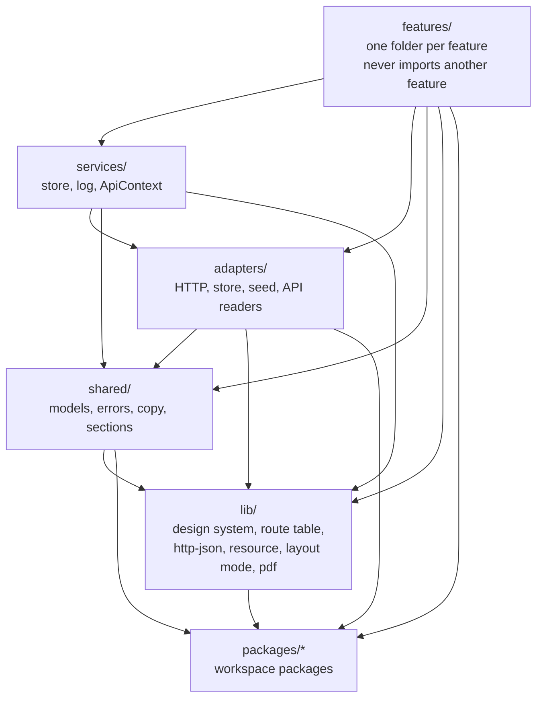

# Architecture

Mijn Duinzicht is a Bun workspace with two apps and five packages. The portal is a React single-page
application served by Bun's dev server; the API is a `Bun.serve` REST JSON server over a SQLite file.
The browser only ever talks to the portal's dev server, which proxies `/api/*` to the API.

## The parts

| Part | Path | What it does |
|---|---|---|
| Portal dev server | `apps/web/src/devServer.ts` | Serves `index.html` (and the bundled `main.tsx`) for every path, proxies `/api/*` to the API, answers 502 `apiUnreachable` when the API is down, opens the browser |
| Portal | `apps/web/src/` | React 19 with React Router; every page renders inside `PortalLayout` (skip link, header, `<main>`) |
| API | `apps/api/src/` | `main.ts` prepares the store and starts `createApiServer`, which composes the route tables from `apiRouteTables.ts` |
| Store | `apps/api/src/services/store/` | `PortalStore`: one connection and one transaction per call, commit on return, rollback on throw |
| Seed | `apps/api/resources/seed.json` | Sanne de Vries, her preferences, 4 policies, 3 claims, 3 messages |
| `@mijn-duinzicht/api-contract` | `packages/api-contract/` | Wire types of every request and answer, and `ApiErrorWire` |
| `@mijn-duinzicht/record-reader` | `packages/record-reader/` | `RecordReader`: reads untrusted values field by field into a verdict |
| `@mijn-duinzicht/dutch-format` | `packages/dutch-format/` | `DutchFormat`: money, dates and the customer number in Dutch notation |
| `@mijn-duinzicht/claim-report-rules` | `packages/claim-report-rules/` | Incident date, description and category-to-policy rules for a new claim |
| `@mijn-duinzicht/profile-detail-rules` | `packages/profile-detail-rules/` | Trimming, validation and limits of the editable profile fields |

A package exports its files one by one (`@mijn-duinzicht/dutch-format/DutchFormat`); there are no
barrel files.

## What the portal shows

| Route | Page | Shows |
|---|---|---|
| `/` | `features/overview/OverviewPage.tsx` | The greeting hero: "Goedemorgen, Sanne", how many policies and open claims she has, and two buttons |
| `/polissen`, `/schade`, `/profiel`, `/berichten` | `features/<section>/<Section>Page.tsx` | A placeholder page: breadcrumb, heading and "Deze pagina is nog in aanbouw." |
| anything else | `features/shell/NotFoundPage.tsx` | "Pagina niet gevonden" with a button back to the overview |

The header (`features/shell/`) shows the wordmark, the primary navigation, the utility links and the
avatar block on wide screens, and a menu button with a disclosure panel below 900px. Route builders
live in `shared/sections/PortalPath.ts`. The API already serves every endpoint in
[rest-api.md](./rest-api.md), also those no page reads yet.

## A page load, step by step

What happens when Sanne opens `http://localhost:3000/`:

If a read fails (the API is down, answers an error or sends a body the reader rejects), the verdict is
`failed`, the hero shows an `ErrorBanner`, and its retry repeats only the failed reads. A read with no
answer within 10 seconds counts as failed.

The same layers apply to a write: a feature calls an adapter, the adapter sends JSON (or `FormData`
for photos) through `requestJson`, the API handler reads the body with `JsonRequestBody` and
`RecordReader`, checks the rules, writes through a writer inside `store.write(work)` and answers the
new state or an `ApiErrorWire`.

## Folder layering

Both apps use the same folders inside `src/`. Arrows point in the direction a file may import.

| Folder | In the API | In the portal |
|---|---|---|
| `features/` | `claims`, `messages`, `open-actions`, `payments`, `policies`, `preferences`, `profile`: routes, handlers and rules | `overview`, `shell`, and a placeholder page per section |
| `adapters/` | `http/` (wire mapping, error answers, body and upload readers), `store/` (ingestion and writers per table group, migrations), `seed/` | `ProfileAdapter`, `PolicyAdapter`, `ClaimAdapter`, `ApiReadUtil` |
| `services/` | `store/` (`PortalStore`, seeding, reset), `log/`, `ApiContext` | none yet |
| `lib/` | `route-table/`, `pdf/` | `design-system/`, `http-json/`, `resource/`, `layout-mode/` |
| `shared/` | `model/`, `errors/` (`PortalError`), `log/` | `model/`, `copy/`, `placeholder/`, `sections/` |

Configuration is read in one module per app: `apps/api/src/ApiEnvironment.ts` and
`apps/web/src/WebEnvironment.ts`. The rules behind this layout are in
[coding-conventions.md](./coding-conventions.md).

## Adding a feature

| Side | Where it goes |
|---|---|
| API | A folder `apps/api/src/features/<name>/` with `<name>Routes.ts` and its handlers, added to `apiRouteTables.ts`; wire types in `packages/api-contract/` |
| Store | A new migration in `adapters/store/migrations/` and a new structure version; ingestion and a writer in `adapters/store/<group>/` |
| Portal | A folder `apps/web/src/features/<name>/` with its page and copy file, a route in `portalRoutes.tsx`, an adapter in `adapters/` when it reads the API |
| Docs | The changed endpoints and tables in [rest-api.md](./rest-api.md), new components or tokens in [design-system.md](./design-system.md) |
