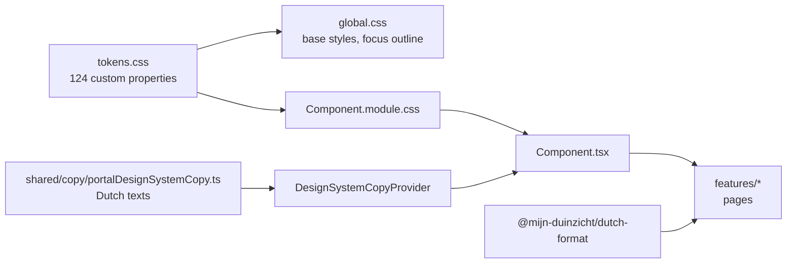

# Design system

The design system lives in `apps/web/src/lib/design-system/`: the tokens, the global rules and a
catalogue of React components. It holds no customer-facing wording; the portal supplies its Dutch
texts once through `DesignSystemCopyProvider`. Build a page from these parts before you build
anything new.

Every component has its own `<Component>.tsx`, a `<Component>.module.css` and a
`<Component>.spec.tsx` beside it. Import the one file you need; there is no barrel file.

## Rules

- **Tokens only.** Colours and lengths come from `tokens.css`. `tokenUsage.spec.ts` fails when a
  design-system stylesheet holds a literal colour or length, or when `tokens.css` defines a token
  that is not on its list. A new token goes into both files.
- **Compose, do not restyle.** Components take no `className` or `style`. If a page needs something
  the catalogue lacks, add a component (with its spec) or a variant.
- **Square corners** everywhere except icon circles, avatars, toggles and round skeletons.
- **No animations or transitions.**
- **Focus.** Every focusable element shows a 2px green outline with a 2px offset
  (`:focus-visible` in `global.css`).
- **Icons are decorative.** `Icon` is always hidden from assistive technology; the control around it
  carries the name.
- **Contrast.** Every text pair below meets 4.5:1. Green text appears only as a hover colour on light
  backgrounds.
- **Dutch copy stays outside.** Pages pass their Dutch text as props; the fixed texts the components
  need come from the copy provider.

## Tokens

### Colours

| Token | Value | Use |
|---|---|---|
| `--ink` | `#141414` | Text, secondary button, outline border |
| `--muted` | `#5E5B55` | Secondary text |
| `--body-2` | `#3A3833` | Lead and body copy |
| `--line` | `#E6E3DD` | Borders, todo progress bar, timeline connector |
| `--line-soft` | `#EEEBE5` | Dividers, skeleton blocks |
| `--surface` | `#FFFFFF` | Page and cards |
| `--surface-grey` | `#F4F3F1` | Utility bar, grey sections |
| `--cream` | `#FDF6E1` | Accent sections, cream icon circle |
| `--amber` | `#EBA72A` | Primary button, wordmark dot |
| `--amber-dark` | `#C98A14` | Primary button bottom border |
| `--amber-icon` | `#B5790C` | Current timeline step, attention icons |
| `--sage` | `#E8F0E2` | Icon circle, avatar |
| `--green` | `#2F7A4F` | Success, hover, focus outline, toggle on, done step |
| `--red` | `#C2412D` | Field error border |
| `--toggle-off` | `#C9C5BD` | Toggle track off |
| `--step-todo` | `#A7A39B` | Todo timeline icon |
| `--field-border` | `#8C887F` | Input border |
| `--ok-bg` / `--ok-fg` | `#DCEBDD` / `#1F5A36` | `ok` badge |
| `--warn-bg` / `--warn-fg` | `#FCEBC4` / `#7A4E00` | `warn` badge |
| `--err-bg` / `--err-fg` | `#F8DDD7` / `#8A2A18` | `err` badge, error banner, field error message |
| `--info-bg` / `--info-fg` | `#DCE7F3` / `#1D4A7A` | `info` badge |
| `--neutral-bg` / `--neutral-fg` | `#EEEBE5` / `#3A3833` | `neutral` badge |

### Typography

| Token | Value |
|---|---|
| `--font-head` | `'Zilla Slab', serif` (headings, weight 500) |
| `--font-body` | `'Figtree', system-ui, sans-serif` |
| `--font-icon` | `'Material Symbols Outlined'` |
| `--weight-regular` / `-medium` / `-semibold` / `-bold` | 400 / 500 / 600 / 700 |
| `--font-size-display` | 44px |
| `--font-size-h1` / `--font-size-h2` / `--font-size-h2-detail` | 40px / 34px / 30px |
| `--font-size-title-large` / `--font-size-title` / `--font-size-title-small` | 28px / 24px / 22px |
| `--font-size-step-heading` | 20px |
| `--font-size-lead` / `--font-size-large` | 18px / 17px |
| `--font-size-body` / `--font-size-medium` / `--font-size-small` / `--font-size-caption` | 16px / 15px / 14px / 13px |
| `--font-size-wordmark` / `--font-size-wordmark-tagline` | 30px / 12px |
| `--line-height-display` / `-lead` / `-compact` / `-wordmark` | 1.1 / 1.5 / 1.2 / 1 |
| `--letter-spacing-wordmark` / `--letter-spacing-tagline` | -0.5px / 1.5px |

The fonts load from Google Fonts in `apps/web/src/index.html`.

### Icon sizes

`--icon-size-small` 18px, `--icon-size-medium` 20px, `--icon-size-default` 24px,
`--icon-size-large` 28px, `--icon-size-extra-large` 32px.

### Spacing

| Kind | Tokens |
|---|---|
| Scale | `--space-4`, `-8`, `-12`, `-14`, `-16`, `-20`, `-24`, `-28`, `-32`, `-40`, `-48`, `-64` |
| Off-scale steps | `--space-2`, `-6`, `-10`, `-11`, `-18`, `-22`, `-26` |

The number is the length in pixels: `--space-24` is 24px.

### Borders, radius, shadows

| Token | Value |
|---|---|
| `--border-hairline` / `--border-field` / `--border-emphasis` | 1px / 1.5px / 2px |
| `--active-bar` | 3px (active navigation item) |
| `--radius` / `--radius-round` / `--radius-toggle` | 0 / 50% / 12px |
| `--shadow-sm` | `0 1px 6px rgba(20,20,20,.06)` |
| `--shadow-md` | `0 2px 14px rgba(20,20,20,.08)` |

### Layout

| Token | Value | Use |
|---|---|---|
| `--max` / `--max-narrow` / `--max-readable` | 1240px / 960px / 720px | Page column widths, readable card width |
| `--page-min-height` | 80vh | Minimum height of a section page |
| `--gutter` | 24px | Side padding of the page column |
| `--breakpoint` | 900px | Switch between wide and compact layout |
| `--utility-bar-height` / `--main-bar-height` / `--compact-header-height` | 34px / 76px / 64px | Header bars |
| `--avatar-size` | 40px | Avatar circle |
| `--avatar-name-skeleton-width` / `--avatar-number-skeleton-width` | 110px / 120px | Avatar block while loading |
| `--icon-circle-small` / `-medium` / `-large` | 48px / 56px / 64px | `IconCircle` |
| `--touch-target` | 48px | Minimum size of a touch control |
| `--toggle-width` / `-height` / `-knob` / `-inset` | 44px / 24px / 18px / 3px | `Toggle` |
| `--progress-bar-height` | 6px | `ProgressSteps` |
| `--focus-outline-width` / `--focus-outline-offset` | 2px / 2px | Focus outline |
| `--lead-max-width` | 520px | Lead text width |
| `--selected-row-bar` | 4px | Bar beside a selected row |
| `--policy-grid-min-column`, `--overview-card-grid-min-column`, `--tile-min-width` | 270px, 320px, 260px | Minimum column widths of card and tile grids |
| `--policy-list-min-width` / `--policy-list-max-width` | 260px / 360px | A list column beside a detail column |
| `--fact-min-width`, `--callout-text-min-width` | 180px, 200px | Minimum widths of fact and callout text |
| `--key-column-min-width` / `--key-column-max-width` | 140px / 240px | The key column of a key and value row |
| `--postcode-field-width` | 160px | A short input such as a postcode |

## Layout modes

The portal has two layout modes, switched at `--breakpoint` (900px):

| Mode | Viewport | What changes |
|---|---|---|
| `wide` | 900px and wider | Full header with navigation; `TwoColumnGrid` shows two columns |
| `compact` | narrower than 900px | Compact header with a menu button; `TwoColumnGrid` stacks its children in source order |

`lib/layout-mode/LayoutMode.ts` writes `data-layout="wide"` or `data-layout="compact"` on `<html>`,
because a custom property cannot be used in a media query. Stylesheets react with
`:root[data-layout='compact'] .className { … }` and hold no width media queries. Components that need
the mode in code call `useLayoutMode()`.

Check every page at 1280px (wide) and 375px (compact).

## Components

| Component | Use it for | Key props |
|---|---|---|
| `ContentColumn` | The centred page column every page sits in | `width`: `regular` (1240px) or `narrow` (960px); `as`: `div`, `section`, `main` |
| `TwoColumnGrid` | Two columns side by side on wide screens, stacked on compact | `template` (the wide `grid-template-columns`), `gap`: `space16`, `space24`, `space40`; `alignItems` |
| `ContentCard` | A white card holding a section of content | `padding`: `space24` to `space40`; `elevation`: `raised` or `flat`; `title`, `titleLevel` 2 or 3; `isReadableWidth` |
| `Breadcrumb` | The trail at the top of a section page | `items: { label, to? }[]`; the last item is the current page |
| `Button` | An action that does not navigate (submit, save, open a panel) | `variant`: `primary`, `secondary`, `outline`; `size`: `regular`, `small`; `leadingIcon`, `type`, `isDisabled`, `onClick` |
| `ButtonLink` | Navigation that should look like a button, or a file download | Same look as `Button`; `to` for a route, or `href` with `downloadFileName` |
| `TextLink` | An inline link to another page | `to`; `chevron`: `trailing`, `leading`, `none` |
| `TextButton` | A small action that looks like a link, such as "Wijzigen" or "Annuleren" | `onClick`, `leadingIcon`, `isExpanded`, `isDisabled` |
| `LinkCard` | A clickable row that leads to a detail page | `to`, `title`, `subtitle`, `leadingIcon`, `variant`: `raised` or `flat`, `titleEmphasis`, `titleSuffix`, `titleSize` |
| `IconTile` | A large tile that leads somewhere, in a grid of tiles | `to`, `icon`, `title`, `hasChevron` |
| `Icon` | A Material Symbols icon | `name` (the ligature, such as `home`); `size`: `small` to `extraLarge` |
| `IconCircle` | A decorative icon in a coloured circle | `icon`; `size`: `small`, `medium`, `large`; `tone`: `sage` or `cream` |
| `StatusBadge` | A short status label | `tone`: `ok`, `warn`, `err`, `info`, `neutral`; `label` |
| `Field` | A labelled text input or textarea | `label`, `value`, `onChange`, `name`, `type`, `hint`, `errorMessage`, `rows`, `isReadOnly`, `isDisabled` |
| `Toggle` | An on-off setting | `isChecked`, `onChange`, `labelId`, `descriptionId`; pass `children` to make the whole row the switch |
| `ProgressSteps` | A compact row of bars showing how far a process is | `stepStates: ('done' \| 'current' \| 'todo')[]`, `currentIsHighlighted`, `accessibleLabel` |
| `Timeline` | The full list of steps of a process, with descriptions | `steps: { title, description, state }[]`, `accessibleLabel` |
| `LoadingRegion` | Wraps the skeleton of a region while it loads and announces it | `children` (the skeleton blocks) |
| `SkeletonBlock` | A grey placeholder shaped like the content it replaces | `width`, `height` (token references or percentages); `shape`: `block`, `round`, `pill` |
| `ErrorBanner` | A failed read, with a retry | `onRetry`, `message`, `variant`: `regular` or `compact`, `isRetryDisabled` |
| `VisuallyHidden` | Text for screen readers only | `children`, `as`: `span` or `div` |
| `DesignSystemCopyProvider` | Supplies the fixed texts; wraps the app once in `main.tsx` | `copy` |

### Picking between similar components

| You want | Use |
|---|---|
| To do something on this page | `Button`, or `TextButton` for a quiet action |
| To go to another page | `TextLink` inline, `ButtonLink` as a call to action, `LinkCard` for a row in a list, `IconTile` in a grid |
| To show a process | `ProgressSteps` in a summary, `Timeline` on a detail page |
| To show loading | `LoadingRegion` around `SkeletonBlock`s shaped like the content |
| To show a failed read | `ErrorBanner` with a retry; `compact` only inside the header |

### Loading and errors

Read data with `useResource(load, key)` from `lib/resource/useResource.ts`. It answers `loading`,
`loaded`, `notFound` or `failed`, gives up after 10 seconds and offers `retry()`. Show:

| State | Show |
|---|---|
| `loading` | `LoadingRegion` with `SkeletonBlock`s |
| `loaded` | The content |
| `notFound` | The page's own not-found message |
| `failed` | `ErrorBanner` whose retry calls `retry()` |

## Fixed texts

`apps/web/src/shared/copy/portalDesignSystemCopy.ts` supplies:

| Key | Dutch text |
|---|---|
| `loadingAnnouncement` | Bezig met laden… |
| `retryAction` | Opnieuw proberen |
| `defaultErrorMessage` | Er ging iets mis bij het laden. Probeer het opnieuw. |
| `compactErrorMessage` | Laden mislukt |
| `breadcrumbNavigationName` | Kruimelpad |
| `timelineStateLabels` | Afgerond, Huidige stap, Nog te doen |
| `progressStepsText(doneCount, totalCount)` | "2 van 4 stappen afgerond" |

A component rendered outside the provider throws, so specs render inside
`DesignSystemCopyProvider` with `PORTAL_DESIGN_SYSTEM_COPY`.

## Dutch formats

`@mijn-duinzicht/dutch-format/DutchFormat` turns internal values into Dutch notation at the moment a
page renders them:

| Function | Input | Output |
|---|---|---|
| `money(cents)` | `3210` | `€ 32,10` |
| `longDate(isoDate)` | `2026-11-01` | `1 november 2026` |
| `shortDate(isoDate)` | `2026-10-06` | `6 okt 2026` |
| `monthYear(isoDate, monthStyle)` | `2025-05-14`, `'short'` | `mei 2025` |
| `dayMonth(isoDate)` | `2026-10-15` | `15 okt` |
| `dateAndTime(isoDateTime)` | `2026-10-06T09:14` | `6 oktober 2026, 09:14` |
| `customerNumber(digits)` | `40218773` | `40 218 773` |
