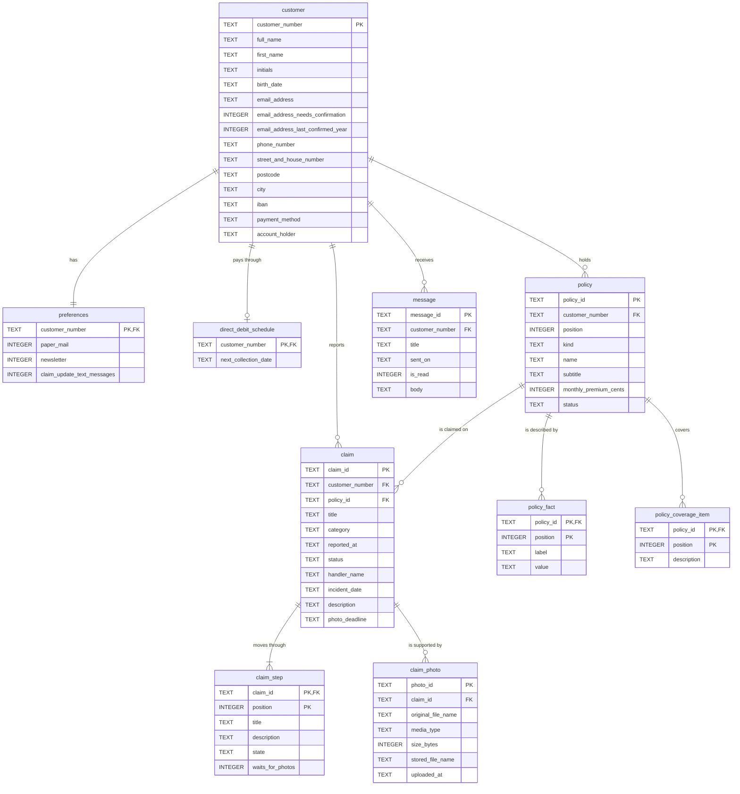

# REST API

The API runs on `http://localhost:3001`. The portal proxies `/api/*`, so in the browser every call
goes to `http://localhost:3000/api/...`. One customer, Sanne de Vries (customer number 40218773), is
always logged in; there is no authentication.

Wire types live in `packages/api-contract/src/`; import the one you need, for example
`@mijn-duinzicht/api-contract/PolicyWire`. Routes are declared per feature in
`apps/api/src/features/<name>/<name>Routes.ts` and composed in `apps/api/src/apiRouteTables.ts`.

## Conventions

| Topic | Rule |
|---|---|
| Bodies | JSON, sent as `application/json`, except the policy sheet (PDF) and the photo upload (`multipart/form-data`) |
| Field names | English camelCase; internal values are English (`active`, `inProgress`) |
| Customer text | Titles, names, descriptions and fact values in the seed are Dutch and passed through as they are |
| Dates | `YYYY-MM-DD` |
| Date-times | `YYYY-MM-DDTHH:MM`, local time in Europe/Amsterdam |
| Amounts | Integer euro cents (`3210` is € 32,10) |
| Ids | Matched exactly and case-sensitively |
| Other methods | A known path with an unsupported method answers 405 `operationNotOffered` |
| Unknown paths | Any other `/api/*` path answers 404 `routeNotFound` |

## Endpoints

| Method and path | Answers |
|---|---|
| `GET /api/profile` | Sanne's profile |
| `PUT /api/profile/contact-details` | Changes e-mail, phone and address |
| `PUT /api/profile/payment-details` | Changes IBAN and account holder |
| `GET /api/preferences` | Her three communication preferences |
| `PATCH /api/preferences` | Changes one or more preferences |
| `GET /api/policies` | Her policies |
| `GET /api/policies/:policyId` | One policy with facts and coverage |
| `GET /api/policies/:policyId/policy-sheet` | The policy sheet as a one-page PDF |
| `GET /api/claims` | Her claims |
| `GET /api/claims/:claimId` | One claim with its steps |
| `POST /api/claims` | Reports a new claim |
| `POST /api/claims/:claimId/photos` | Uploads photos for a claim that waits for them |
| `GET /api/messages` | Her messages |
| `GET /api/messages/:messageId` | One message with its body |
| `PUT /api/messages/:messageId/read` | Marks a message read |
| `GET /api/payments/next` | The next direct-debit collection |
| `GET /api/open-actions` | What Sanne still has to do |

Every endpoint can also answer 500 (`storeUnavailable`, `invalidStoredValue`, `internalError`); the
tables below list only the other errors.

### Profile

**`GET /api/profile`** answers 200 with a `ProfileWire`:

```json
{
  "customerNumber": "40218773",
  "fullName": "Sanne de Vries",
  "firstName": "Sanne",
  "initials": "SV",
  "birthDate": "1988-06-14",
  "emailAddress": "sanne.devries@example.nl",
  "emailAddressNeedsConfirmation": true,
  "emailAddressLastConfirmedYear": 2023,
  "phoneNumber": "06 12 34 56 78",
  "address": { "streetAndHouseNumber": "Lindelaan 12", "postcode": "3521 AB", "city": "Utrecht" },
  "iban": "NL91 INGB 0001 2348 21",
  "paymentMethod": "monthlyDirectDebit",
  "accountHolder": "S. de Vries"
}
```

**`PUT /api/profile/contact-details`** takes
`{ emailAddress, phoneNumber, streetAndHouseNumber, postcode, city }`, all strings, all required. It
answers 200 with the `ProfileWire` after the write and also marks the e-mail address confirmed.

**`PUT /api/profile/payment-details`** takes `{ iban, accountHolder }` and answers 200 with the
`ProfileWire`.

The profile rules (trimming, formats, limits) live in `@mijn-duinzicht/profile-detail-rules`.

| Status | Code | When |
|---|---|---|
| 400 | `malformedRequest` | The body is not a JSON object |
| 422 | `validationFailed` | Per field: `required`, `invalidFormat`, `tooLong` (e-mail at most 254 characters, other text at most 100), `readOnlyField` for another profile field, `unknownField` |

### Preferences

**`GET /api/preferences`** answers 200 with `{ "paperMail": false, "newsletter": true, "claimUpdateTextMessages": true }`.

**`PATCH /api/preferences`** takes any non-empty subset of the three booleans and answers 200 with
all three after the write.

| Status | Code | When |
|---|---|---|
| 400 | `malformedRequest` | The body is not a JSON object |
| 422 | `validationFailed` | `preferences: required` for an empty object, `<name>: invalidFormat` for a value that is not a boolean, `<key>: unknownField` |

### Policies

**`GET /api/policies`** answers 200 with `{ "policies": PolicySummaryWire[] }` in seed order:

```json
{
  "id": "DZ-WH-118204",
  "policyNumber": "DZ-WH-118204",
  "kind": "home",
  "name": "Woonhuisverzekering",
  "subtitle": "Lindelaan 12, Utrecht",
  "monthlyPremiumCents": 3210,
  "status": "active"
}
```

`kind` is `home`, `contents`, `car` or `liability`; `status` is `active` or `ended`. `policyNumber`
equals `id`.

**`GET /api/policies/:policyId`** answers 200 with a `PolicyDetailWire`: the summary plus
`facts: [{ label, value }]` (for example `{ "label": "Eigen risico", "value": "€ 250" }`) and
`coverage: string[]`. Unknown id: 404 `notFound`.

**`GET /api/policies/:policyId/policy-sheet`** answers 200 `application/pdf`, one A4 page, with
`content-disposition: attachment; filename="polisblad-<policy number>.pdf"`. Unknown id: 404
`notFound`.

### Claims

**`GET /api/claims`** answers 200 with `{ "claims": ClaimSummaryWire[] }`:

```json
{
  "id": "S-2026-0418",
  "title": "Waterschade badkamer",
  "category": "home",
  "policyId": "DZ-WH-118204",
  "policyName": "Woonhuisverzekering",
  "reportedAt": "2026-10-06T09:14",
  "status": "inProgress",
  "handlerName": "Joost Meijer",
  "stepStates": ["done", "done", "current", "todo"],
  "awaitsCustomerPhotos": true
}
```

`category` is `home`, `car`, `travel` or `liability`; `status` is `reported`, `inProgress`, `paidOut`
or `rejected`; `handlerName` may be `null`. Order: open claims (`reported`, `inProgress`) first, then
the newest reported first, then id ascending.

**`GET /api/claims/:claimId`** answers 200 with a `ClaimDetailWire`: the summary without
`stepStates`, plus `incidentDate`, `description` and `photoDeadline` (each may be `null`) and
`steps: [{ title, description, state, waitsForPhotos }]`. Unknown id: 404 `notFound`.

**`POST /api/claims`** takes `{ category, policyId, incidentDate, description }`. It answers 201 with
the new `ClaimDetailWire` and a `Location: /api/claims/<id>` header. The new id is
`S-<year>-<NNNN>`, the status `reported`, with four steps of which the second is current. The rules
live in `@mijn-duinzicht/claim-report-rules`.

| Status | Code | When |
|---|---|---|
| 400 | `malformedRequest` | The body is not a JSON object |
| 422 | `validationFailed` | Per field, in field order: `required`, `invalidFormat`, `inFuture` (incident date after today in Amsterdam), `tooShort` or `tooLong` (trimmed description 10 to 2000 characters), `notEligible`, `unknownField` |
| 409 | `claimSequenceExhausted` | No claim number is left for the year |

A policy is eligible when it exists, is active and fits the category: `home` on a home or contents
policy, `car` on a car policy, `travel` on a contents policy, `liability` on a liability policy.

**`POST /api/claims/:claimId/photos`** takes `multipart/form-data` with only file parts named
`photos`. It answers 200 with the `ClaimDetailWire` after the receipt: the waiting step is done, the
next step current and the deadline cleared. Files are stored in the upload directory and removed
again on any failure. Errors are checked in this order:

| Status | Code | When |
|---|---|---|
| 404 | `notFound` | Unknown claim |
| 400 | `malformedRequest` | Not valid multipart, or a part that is not a file named `photos` |
| 409 | `photosNotExpected` | The claim does not wait for photos |
| 422 | `photoCountOutOfRange` | Not 1 to 10 photos |
| 415 | `unsupportedPhotoType` | A file that is not JPEG, PNG or HEIC by its content |
| 413 | `photoTooLarge` | A file over 10 485 760 bytes (10 MiB) |

### Messages

**`GET /api/messages`** answers 200 with `{ "messages": [{ id, title, sentOn, isRead }] }`, newest
first, id ascending on a tie.

**`GET /api/messages/:messageId`** answers 200 with the summary plus `body`. Unknown id: 404
`notFound`.

**`PUT /api/messages/:messageId/read`** ignores its body and answers 200 with the message detail, now
`isRead: true`. Calling it twice is harmless. Unknown id: 404 `notFound`.

### Payments

**`GET /api/payments/next`** answers 200 with:

```json
{ "nextPayment": { "collectionDate": "2026-11-01", "amountCents": 9845, "maskedAccount": "NL•• INGB •••• 4821" } }
```

The amount is the sum of the monthly premiums of the active policies. `nextPayment` is `null` when
there is no direct-debit schedule.

### Open actions

**`GET /api/open-actions`** answers 200 with `{ "openActions": OpenActionWire[] }`, derived on every
read:

| `kind` | Fields | When |
|---|---|---|
| `uploadClaimPhotos` | `claimId`, `claimTitle`, `deadline` | Per open claim whose current step waits for photos, ordered by deadline, then claim id |
| `confirmEmailAddress` | `lastConfirmedYear` | When the e-mail address needs confirmation; always last |

## Errors

Every error has the same body (`ApiErrorWire`):

```json
{
  "error": {
    "code": "validationFailed",
    "message": "The claim report is not valid.",
    "fieldErrors": [{ "field": "description", "reason": "tooShort" }]
  }
}
```

`fieldErrors` appears only with `validationFailed`. The `message` is English and meant for
developers; the portal words errors for the customer itself.

| Code | Status | When |
|---|---|---|
| `notFound` | 404 | Unknown id |
| `routeNotFound` | 404 | No endpoint has the path |
| `operationNotOffered` | 405 | The path exists, but not for this method |
| `malformedRequest` | 400 | The body is not a JSON object sent as `application/json` (or not valid multipart for photos) |
| `validationFailed` | 422 | One or more field errors |
| `photoCountOutOfRange` | 422 | Not 1 to 10 photos |
| `photosNotExpected` | 409 | The claim does not wait for photos |
| `claimSequenceExhausted` | 409 | No claim number left for the year |
| `photoTooLarge` | 413 | A photo over 10 MiB |
| `unsupportedPhotoType` | 415 | A photo that is not JPEG, PNG or HEIC |
| `storeUnavailable` | 500 | The store is missing, unreadable or has another structure version |
| `invalidStoredValue` | 500 | A stored value fails validation (the API fails closed) |
| `internalError` | 500 | Anything unexpected |
| `apiUnreachable` | 502 | Sent by the portal's dev server when the API does not answer |

Field error reasons: `required`, `invalidFormat`, `tooShort`, `tooLong`, `inFuture`, `notEligible`,
`readOnlyField`, `unknownField`.

## The data

The store is one SQLite file (default `.data/portal.sqlite`), created and seeded from
`apps/api/resources/seed.json` on the first start and replaced by `bun run reset`. Its structure
version is kept in `PRAGMA user_version` (currently 1); the tables are created in
`apps/api/src/adapters/store/migrations/`. The API refuses to start on a store it cannot read or with
another structure version, and tells you to run `bun run reset`.



| Table | Notes |
|---|---|
| `customer` | One row: Sanne. `payment_method` is `monthlyDirectDebit` |
| `preferences` | Booleans stored as 0 or 1 |
| `direct_debit_schedule` | The next collection date; no row means no next payment |
| `policy` | `position` keeps the seed order; `kind` and `status` hold the English internal values |
| `policy_fact`, `policy_coverage_item` | Ordered by `position` |
| `claim` | Id `S-YYYY-NNNN`; `incident_date`, `description` and `photo_deadline` are empty for older claims |
| `claim_step` | At most one step per claim is `current` (a unique index enforces it) |
| `claim_photo` | Metadata of an uploaded photo; the file itself is in the upload directory (default `.data/uploads/`) |
| `message` | `is_read` is 0 or 1 |

Every table uses SQLite's `STRICT` mode and `CHECK` constraints for formats and allowed values.

### The seed

| What | Values |
|---|---|
| Customer | Sanne de Vries, 40218773, Lindelaan 12, 3521 AB Utrecht |
| Policies | `DZ-WH-118204` Woonhuisverzekering, `DZ-IB-118205` Inboedelverzekering, `DZ-AU-902117` Autoverzekering, `DZ-AV-330981` Aansprakelijkheid, all active |
| Claims | `S-2026-0418` Waterschade badkamer (in progress, waits for photos until 2026-10-15), `S-2025-0127` Ruitschade voorruit (paid out), `S-2023-0352` Gestolen fiets (paid out) |
| Messages | `M-2026-0103` (unread), `M-2026-0087`, `M-2026-0021` |

The seed file uses Dutch enumeration values (for example `in_behandeling`); `SeedIngestion` maps them
to the English internal values when the store is built. All data is fictional.

Every store access goes through `PortalStore`: `store.read(work)` or `store.write(work)` opens one
connection, runs the work in one transaction, commits on return and rolls back on a throw.
